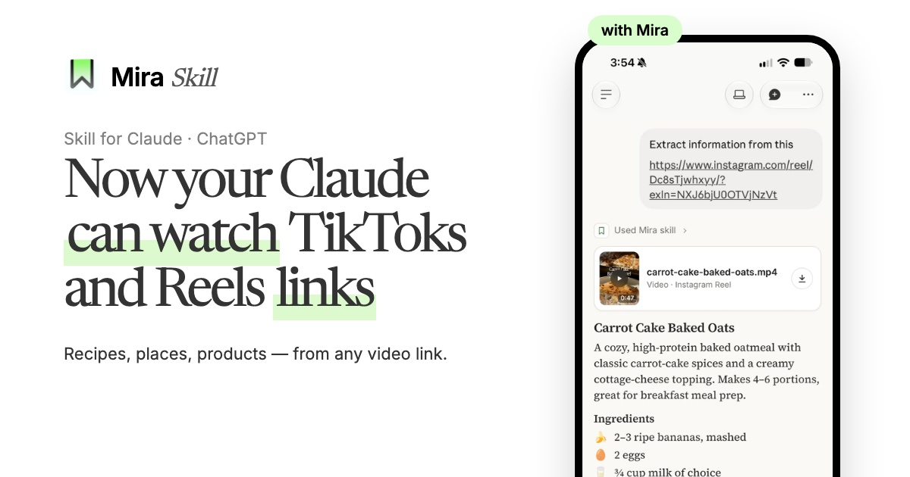
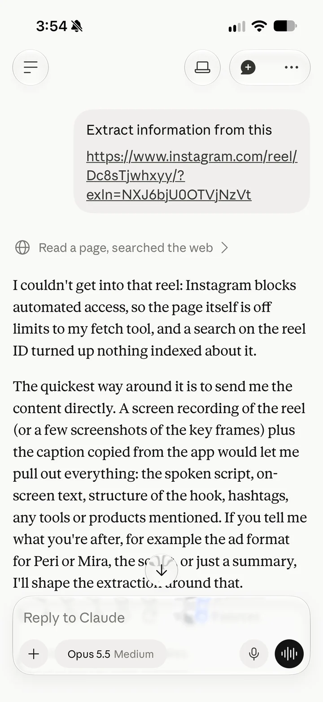
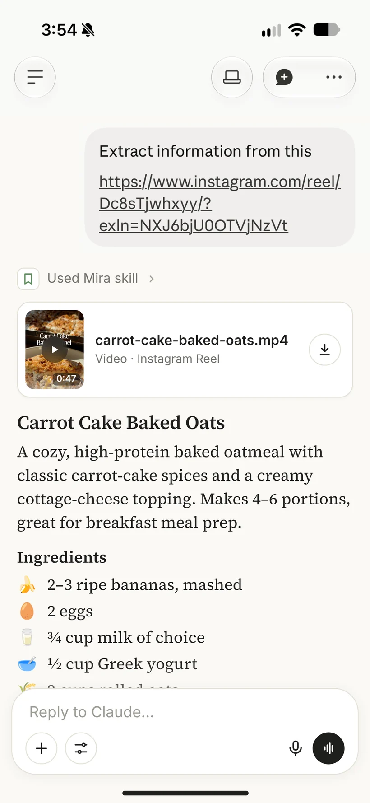

<p align="center">
  
</p>

<h1 align="center">TikTok, Instagram Reels &amp; YouTube Video Transcript for Claude and ChatGPT — Mira</h1>

<p align="center">
  <b>Mira Video Transcript</b> is an agent skill and MCP connector that lets <b>Claude</b> and <b>ChatGPT</b> watch video links from<br>
  <b>Instagram, TikTok, YouTube, Pinterest, X (Twitter) and Facebook</b>: transcript, on-screen text, caption,<br>
  a structured extract, and the original video download.
</p>

<p align="center">
  <a href="https://mira-ai-skill.pro"><b>Website</b></a> ·
  <a href="#install">Install</a> ·
  <a href="#what-you-can-ask">Examples</a> ·
  <a href="#faq">FAQ</a>
</p>

<p align="center">
  
</p>

## Why

Claude and ChatGPT can't open TikTok, Instagram or YouTube links — they hit a login wall or see only the page title. A lot of useful knowledge now lives in short videos: recipes, travel spots, product reviews, workouts, tutorials.

**Mira watches the video for your assistant.** It reads the key frames, the on-screen text, the caption and the voiceover, and hands Claude one full extract — so it answers from the whole video, not a guess from the title.

<table>
  <tr>
    <td align="center"><b>Without Mira</b></td>
    <td align="center"><b>With Mira</b></td>
  </tr>
  <tr>
    <td></td>
    <td></td>
  </tr>
</table>

## What you get

- 🗣️ **Voiceover transcript** — what was said in the video
- 🔤 **On-screen text** — captions, subtitles and text overlays from the frames
- 📝 **Caption** — the description under the post
- 🧩 **Structured extract** — places with addresses and ratings, recipes with ingredients and steps, products, books, movies, workouts, study notes
- 🎬 **Original video file** — the MP4, or every photo and video of a carousel *(Extract + Video plan)*, with an in-chat player in Claude and ChatGPT

## Supported platforms

| Platform | Links |
|---|---|
| **TikTok** | videos, photo carousels, `vm.tiktok.com` short links |
| **Instagram** | Reels, posts, carousels |
| **YouTube** | Shorts and regular videos (long videos too) |
| **Pinterest** | video pins |
| **X (Twitter)** | posts with video |
| **Facebook** | public videos and reels |
| **Web pages** | articles, recipes, any public page |

## What you can ask

> *"What's the recipe in this Reel? Turn it into a shopping list."* — `https://www.instagram.com/reel/…`

> *"List every place from this TikTok with addresses, I'm going to Tokyo next week."*

> *"Translate this YouTube Short to English and summarize it in 3 bullets."*

> *"Which products does this creator recommend, and what do they cost?"*

> *"Break down this competitor's ad: hook, structure, call to action."*

> *"Make study notes from this lesson."*

<h2 id="install">Install</h2>

You need two parts: the **connector** (does the watching) and, optionally, the **skill** (tells the assistant when and how to use it). Your personal connector URL and key arrive on the setup page and by email after you [subscribe](https://mira-ai-skill.pro).

### Claude (claude.ai, Desktop, mobile)

1. **Connector:** Settings → **Connectors** → *Add custom connector* → name it `Mira` and paste your personal connector URL.
2. **Skill:** download [`dist/mira-skill.zip`](dist/mira-skill.zip) → Settings → **Capabilities** → *Skills* → upload it.
3. Start a new chat and paste a video link.

### Claude Code

```bash
/plugin marketplace add Mira-AI-Tools/mira-skill
/plugin install mira@mira-ai-tools
```

Claude Code asks for your key (from the setup email) when the plugin is enabled. To change it later: `/plugin` → **Installed** → **mira** → **Configure options**.

The plugin bundles both the skill and the connector.

### ChatGPT

Settings → **Apps & Connectors** → *Advanced settings* → enable **Developer mode** → *Create* → paste your personal connector URL, authentication: none. Custom connectors are available on ChatGPT plans that support developer mode.

### Other MCP clients (Cursor, Windsurf, VS Code, …)

Mira is a remote MCP server (Streamable HTTP):

```json
{
  "mcpServers": {
    "mira": {
      "type": "http",
      "url": "https://mira-ai-skill.pro/mcp",
      "headers": { "Authorization": "Bearer mira_sk_your_key" }
    }
  }
}
```

Or use your personal connector URL as the server URL with no headers.

Setup for every client (Cursor, VS Code, Windsurf, Gemini CLI, Cline, Codex, …) is in [Mira-AI-Tools/mira-mcp](https://github.com/Mira-AI-Tools/mira-mcp).

### Agent skills CLI

```bash
npx skills add Mira-AI-Tools/mira-skill
```

The skill (`mira-video-transcript`) lives in [`skills/mira-video-transcript/SKILL.md`](skills/mira-video-transcript/SKILL.md) and works in any agent that supports Agent Skills.

## How it works for you

1. You paste a link into the chat.
2. Your assistant calls Mira's `parse_video` tool. Short videos are ready in seconds; long ones take a few minutes, and the assistant picks the result up with `get_result`.
3. The assistant answers your question from the full extract — and on the Extract + Video plan shows the original video right in the chat.

Tools: `parse_video`, `get_result`, `get_account` (plan, today's usage, billing link).

<h2 id="faq">FAQ</h2>

**Which videos work?**
Most public videos. Private, deleted or region-locked videos may not be available, because access depends on each platform.

**Does it work with Claude Code and the API?**
Yes — anything that speaks MCP can use the connector, and the skill follows the open Agent Skills format.

**What happens to the videos I send?**
Video files, transcripts and extracts are deleted from Mira's systems within 21 days. See the [Privacy Policy](https://mira-ai-skill.pro/privacy.html).

**Where can I keep videos I want to come back to?**
In the [Mira app](https://apple.co/4mKOVle) for iPhone — it keeps saved videos sorted and searchable and pins places from videos on a map.

**I lost my connector URL.**
Get a new one at [mira-ai-skill.pro/recover](https://mira-ai-skill.pro/recover) with the email you subscribed with.

---

Mira works with a Mira subscription — see [mira-ai-skill.pro](https://mira-ai-skill.pro).
[Terms](https://mira-ai-skill.pro/terms.html) · [Privacy](https://mira-ai-skill.pro/privacy.html) · [Refunds & cancellation](https://mira-ai-skill.pro/refund.html) · Support: support@mira-ai-skill.pro

Skill files in this repository are released under the [MIT License](LICENSE).
